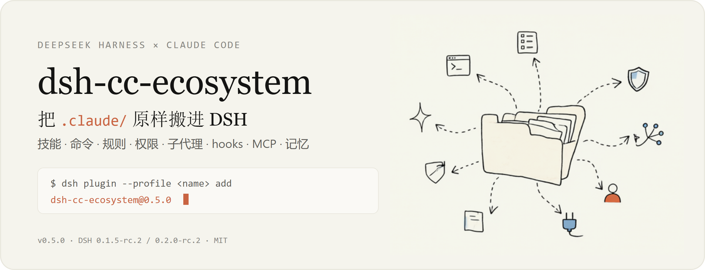
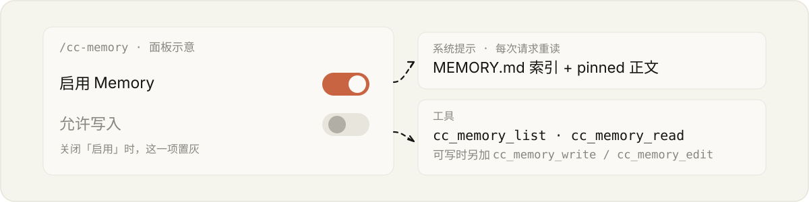

# dsh-cc-ecosystem

English · [中文](README.md)

<p align="center">
  
</p>

**Bring your Claude Code `.claude/` into DeepSeek Harness as-is.** Skills, commands, rules, permissions, subagents, hooks, MCP, and auto-memory are all read using Claude Code's own discovery rules — one copy of the config, maintained once.

<sub>Load your Claude Code `.claude/` assets into DeepSeek Harness as-is — no migration, no second copy.</sub>

> **`.claude` is the single source of truth.** The plugins only read it. The one exception is auto-memory's writable mode (read-only by default); once you turn it on, DSH can add or modify memory files.

## Up and running in 30 seconds

<!-- versions:begin -->
```sh
dsh plugin --profile <name> add dsh-cc-ecosystem@0.6.1
```
<!-- versions:end -->

> **About the anonymous install stats**: the first time DSH uses these packages, and again on every upgrade to a new version, they send us one report — only the package name, version, and operating system (Windows / Mac / Linux), so we know how many people are using them. It contains nothing that can identify you, and never reads your project, config, or conversations.

Restart DSH after installing. In the Web GUI, paste the `name@version` line above straight into the input box.

**Always pin the exact version.** Since pnpm 11, the default `minimumReleaseAge` makes the resolver silently skip any version published less than 24 hours ago — and the exit code still says 0. Upgrading means reinstalling with the new version number; DSH has no "Update" button yet.

<details>
<summary>Why only the exact version is reliable</summary>

| Input | What actually gets installed | Why |
|---|---|---|
| `dsh-cc-ecosystem` / `@latest` | the previous version | dist-tags are not exempt |
| `dsh-cc-ecosystem@^0.6.0` | the new version | exempt only while a single candidate matches the range — breaks on the next release |
| `dsh-cc-ecosystem@0.6.0` | the new version | the only form that stays reliable |

To opt out of the policy, set `minimumReleaseAge: 0` in the profile's `pnpm-workspace.yaml`, or exempt versions one at a time with `minimumReleaseAgeExclude` (you have to add every release, so it rots quickly).
</details>

## What it moves

| Inside `.claude/` | Becomes this in DSH |
|---|---|
| `skills/`, `commands/` | Skills and slash commands, same names and arguments |
| `rules/` | The rules layer, merged across the whole ancestor chain |
| `settings.json` | `allow` / `deny` / `ask` permission gates, evaluated **deny → ask → allow** |
| `agents/*.md` | Dispatchable subagents; the body is the system prompt |
| `hooks/` | All five handler types: command / http / mcp_tool / prompt / agent |
| `~/.claude.json`, `.mcp.json` | MCP servers registered as DSH tools; the `/mcp` panel shows which file each server was read from |
| `projects/<slug>/memory/` | The memory index and pinned bodies in the system prompt; the `/cc-memory` panel |
| Plugin directories | Skills / commands / agents / hooks / MCP inside a plugin, merged in under a namespace |

## Why there is never a second copy

- **Nothing is copied, nothing is written back**: DSH reads `.claude` directly, so changing your config never means syncing a second copy. The auto-memory index is re-read on every request.
- **Discovery follows Claude Code**: skills / commands / subagents walk up from cwd to the git root (home excluded); rules and `.mcp.json` walk up to the filesystem root; `settings.json` only reads `<cwd>/.claude/`.
- **Provenance is visible**: every entry in the management panels shows the scope and the file it was read from, so debugging never means guessing.

## Auto-memory: two switches

<p align="center">
  
</p>

In the `/cc-memory` panel:

- **Enable memory** turned off → DSH cannot see auto-memory at all: no prompt section, no tools.
- Only once it is on does **read-only / writable** come into play. Read-only exposes just `cc_memory_list` / `cc_memory_read`; writable adds `cc_memory_write` / `cc_memory_edit`, following the same two-step "write the file → update the index" flow.
- Both switches are stored in `$DSH_HOME/cc-memory-state.json`; changes take effect immediately, no restart needed.

## Compatibility and limits

<details>
<summary>DSH version requirements and known limitations</summary>

| Your DSH version | Use this |
|---|---|
| `0.1.5-rc.2` or `0.2.0-rc.2` | **`v0.6.0` (current)** — one release line covers both host generations |
| `0.1.0-rc.7` ~ `0.1.1-rc.2` | `v0.1.x` (no longer maintained) |

- **Not every hook event is covered**: of Claude Code's 31 events, 11 have an extension point and actually fire; the rest are parsed but never run.
- **Some subagent fields have no effect**: subagents with `isolation: worktree` do not appear in the catalog; `hooks`, `mcpServers`, and `permissionMode` are ignored with a notice.
- **The LSP bridge (mcpls) is not implemented yet.**
- **Bash and PowerShell are separate tools**: `Bash(rm -rf *)` does not cover PowerShell; each has its own rules.
</details>

<details>
<summary>What the eight packages do</summary>

| Package | What it does |
|---|---|
| [**dsh-cc-ecosystem**](https://www.npmjs.com/package/dsh-cc-ecosystem) | The whole family — one command installs everything below |
| [dsh-cc-skills](https://www.npmjs.com/package/dsh-cc-skills) | Skills, slash commands, rules |
| [dsh-cc-permissions](https://www.npmjs.com/package/dsh-cc-permissions) | Enforces Claude Code permission rules |
| [dsh-cc-agents](https://www.npmjs.com/package/dsh-cc-agents) | Subagent catalog and dispatch |
| [dsh-cc-hooks](https://www.npmjs.com/package/dsh-cc-hooks) | Claude Code hooks |
| [dsh-cc-mcp](https://www.npmjs.com/package/dsh-cc-mcp) | MCP servers and the `/mcp` panel |
| [dsh-cc-memory](https://www.npmjs.com/package/dsh-cc-memory) | Auto-memory and the `/cc-memory` panel |
| [dsh-cc-loader](https://www.npmjs.com/package/dsh-cc-loader) | Shared parse layer (installed automatically, not a plugin) |

For mounting a local checkout, see the `cordis.patch.yml` snippets in each adapter's README; for the changelog, see [CHANGELOG](CHANGELOG.md).
</details>

## License

MIT

`dsh-cc-skills` is derived from [dsh-claude-compat](https://github.com/biedongbin/dsh-claude-compat) (MIT, © biedongbin), and `dsh-cc-loader`'s discovery logic is based on the same foundation; hook semantics follow the official `@deepseek-ai/dsh-hook-protocol`.
