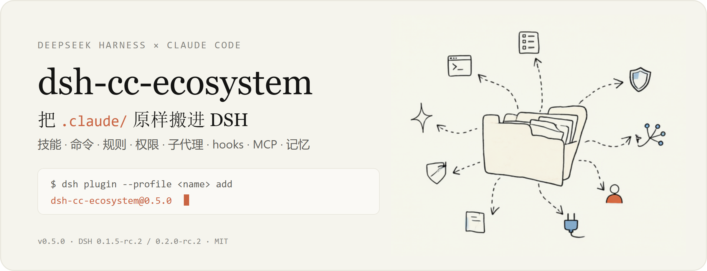
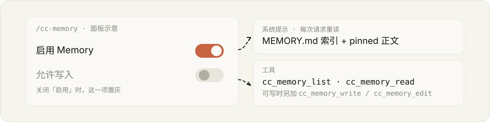

# dsh-cc-ecosystem

<p align="center">
  
</p>

**把 Claude Code 的 `.claude/` 原样接进 DeepSeek Harness。** 技能、命令、规则、权限、子代理、hooks、MCP、auto-memory 都按 Claude Code 自己的发现规则读取 —— 配置只维护一份。

<sub>Load your Claude Code `.claude/` assets into DeepSeek Harness as-is — no migration, no second copy.</sub>

> **`.claude` 是唯一事实来源。** 插件只读它。唯一例外是 auto-memory 的可写模式（默认只读），打开后 DSH 才能新增或修改记忆文件。

## 30 秒上手

<!-- versions:begin -->
```sh
dsh plugin --profile <name> add dsh-cc-ecosystem@0.5.0
```
<!-- versions:end -->

装完重启 DSH。Web GUI 里把上面那段 `包名@版本号` 原样填进输入框即可。

**务必带精确版本号。** pnpm 11 起默认的 `minimumReleaseAge` 会让发布不满 24 小时的版本被解析器静默跳过 —— 退出码照样是 0。升级也是用新版本号重装一次；DSH 目前没有「更新」按钮。

<details>
<summary>为什么只有精确版本可靠</summary>

| 输入 | 实际装到 | 原因 |
|---|---|---|
| `dsh-cc-ecosystem` / `@latest` | 上一个版本 | dist-tag 不豁免 |
| `dsh-cc-ecosystem@^0.5.0` | 新版本 | 范围内只剩一个候选时才豁免 —— 下一版即失效 |
| `dsh-cc-ecosystem@0.5.0` | 新版本 | 只有这种写法稳定 |

不想受这条策略约束，可在 profile 的 `pnpm-workspace.yaml` 里设 `minimumReleaseAge: 0`，或用 `minimumReleaseAgeExclude` 逐版本豁免（每发一版都要补，容易腐烂）。
</details>

## 它搬了什么

| `.claude/` 里的 | 在 DSH 里变成 |
|---|---|
| `skills/`、`commands/` | 技能与斜杠命令，命名与参数照旧 |
| `rules/` | 规则层，按整条祖先链合并 |
| `settings.json` | `allow` / `deny` / `ask` 权限门，求值顺序 **deny → ask → allow** |
| `agents/*.md` | 可派发的子代理，正文即系统提示词 |
| `hooks/` | command / http / mcp_tool / prompt / agent 五类处理器 |
| `~/.claude.json`、`.mcp.json` | MCP server 注册为 DSH 工具；`/mcp` 面板显示每个 server 读自哪个文件 |
| `projects/<slug>/memory/` | 系统提示里的记忆索引与 pinned 正文；`/cc-memory` 面板 |
| 插件目录 | 插件内的技能 / 命令 / agent / hooks / MCP 以命名空间并入 |

## 为什么不会各有一套

- **不复制、不写回**：DSH 直接读 `.claude`，改完配置不需要同步第二份。auto-memory 的索引每次请求重读。
- **发现规则照 Claude Code**：技能 / 命令 / 子代理从 cwd 向上走到 git 根（不含 home）；规则与 `.mcp.json` 走到文件系统根；`settings.json` 只认 `<cwd>/.claude/`。
- **来源可查**：管理面板里每条配置都标出读自哪个作用域、哪个文件，排查不用猜。

## Auto-memory：两个开关

<p align="center">
  
</p>

在 `/cc-memory` 面板里：

- **启用 Memory** 关掉 → DSH 完全看不到 auto-memory：没有提示段，也没有工具。
- 打开后才轮到 **只读 / 可写**。只读只提供 `cc_memory_list` / `cc_memory_read`；可写额外提供 `cc_memory_write` / `cc_memory_edit`，沿用「写文件 → 改索引」两步法。
- 两个开关写入 `$DSH_HOME/cc-memory-state.json`，切换即时生效，无需重启。

## 兼容与限制

<details>
<summary>DSH 版本要求与已知限制</summary>

| 你的 DSH 版本 | 用哪个 |
|---|---|
| `0.1.5-rc.2` 或 `0.2.0-rc.2` | **`v0.5.0`（当前）** —— 一条版本线同时兼容两代 |
| `0.1.0-rc.7` ~ `0.1.1-rc.2` | `v0.1.x`（已停止维护） |

- **Hooks 事件未全覆盖**：Claude Code 的 31 个事件中，11 个有对应扩展点会真正触发；其余会被解析但不运行。
- **子代理的部分字段不生效**：`isolation: worktree` 的子代理不会出现在目录里；`hooks`、`mcpServers`、`permissionMode` 会被忽略并给出提示。
- **LSP 桥接（mcpls）尚未实现**。
- **Bash 与 PowerShell 是独立工具**：`Bash(rm -rf *)` 不覆盖 PowerShell，两者规则各自生效。
</details>

<details>
<summary>八个包分别是什么</summary>

| 包 | 作用 |
|---|---|
| [**dsh-cc-ecosystem**](https://www.npmjs.com/package/dsh-cc-ecosystem) | 全家桶，一条命令装齐下面全部 |
| [dsh-cc-skills](https://www.npmjs.com/package/dsh-cc-skills) | 技能、斜杠命令、rules |
| [dsh-cc-permissions](https://www.npmjs.com/package/dsh-cc-permissions) | CC 权限规则强制 |
| [dsh-cc-agents](https://www.npmjs.com/package/dsh-cc-agents) | 子代理目录与派发 |
| [dsh-cc-hooks](https://www.npmjs.com/package/dsh-cc-hooks) | Claude Code hooks |
| [dsh-cc-mcp](https://www.npmjs.com/package/dsh-cc-mcp) | MCP 服务器与 `/mcp` 面板 |
| [dsh-cc-memory](https://www.npmjs.com/package/dsh-cc-memory) | Auto-memory 与 `/cc-memory` 面板 |
| [dsh-cc-loader](https://www.npmjs.com/package/dsh-cc-loader) | 共享解析层（自动安装，非插件） |

从本地 checkout 热挂载的开发流程见 [DSHCCECO-INSTALL-SKILL.md](DSHCCECO-INSTALL-SKILL.md)；变更记录见 [CHANGELOG](CHANGELOG.md)。
</details>

## License

MIT

`dsh-cc-skills` 派生自 [dsh-claude-compat](https://github.com/biedongbin/dsh-claude-compat)（MIT, © biedongbin），`dsh-cc-loader` 的发现逻辑亦源自该基座；hooks 语义基于官方 `@deepseek-ai/dsh-hook-protocol`。
